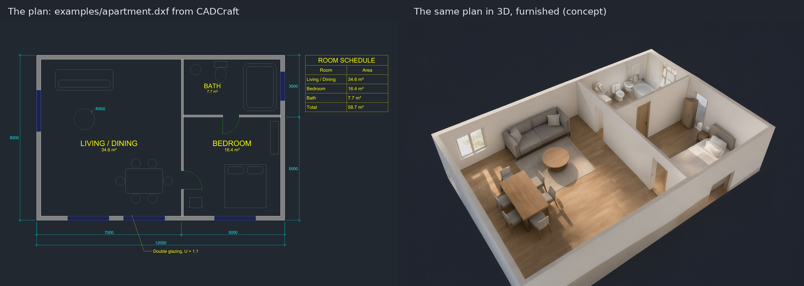
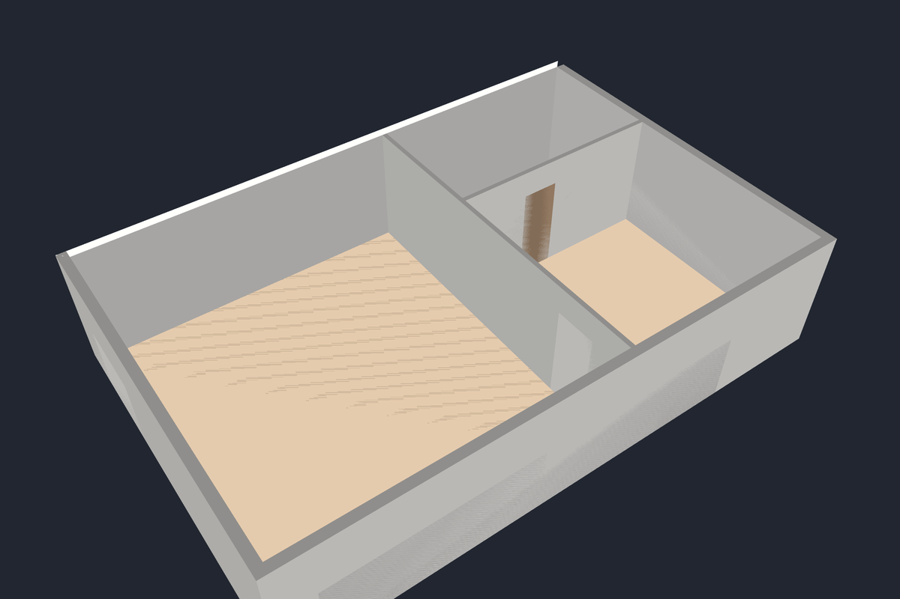

# arch3d — from floor plan to furnished 3D, built in hybrid by open-weight on-prem LLMs and closed cloud AI providers

**arch3d** adds Sweet Home 3D/Chief Architect–style building design to [CADCraft](https://github.com/storytold/cadcraft). You draw walls, doors, windows and rooms in plan, and arch3d builds the house in 3D from them: walls with their openings cut, floors and ceilings for every room, automatic roofs. Next come stairs, railings and decks, a proper 3D view, generated elevations and sections, recognition of plain DXF plans, terrain, lighting, rendering and export. The work lives on this fork's [`arch3d`](https://github.com/andydhamm/cadcraft-arch3d/tree/arch3d) branch, mainly in the `arch`, `arch3d` and `render3d` crates.

*Left: `examples/apartment.dxf` from CADCraft, as CADCraft draws it. Right: where arch3d is going. The walls, doors and windows are arch3d's own model of that plan, placed with its commands and built in 3D; the furniture and finishes are an AI image edit (Qwen-Image 2.1) of arch3d's render. arch3d does not place furniture yet.*

## Who(What) builds it

The code is written by a swarm of AI models, not by hand. Local open-weight models running on consumer & workstation grade compute do most of the work; cloud models take the segments they get stuck on.

- A **lead** model plans each phase into small segments and writes the phase's acceptance checks before any code.
- **Implementer** models work the segments in parallel, each on its own branch. When one segment blocks the rest, idle implementers race it at different sampling temperatures.
- A change merges only after it builds, its tests and the tests of every crate that depends on it pass, and a serial **integrator** has re-run the whole workspace test suite on top of the latest head.
- Two more seats write **extra tests** for work that has already merged.
- A stuck segment **escalates** to a stronger model, then to a human operator, then back to the lead to be re-planned.

People set the plan and review the results. The models write the code and its tests. JBOS orchestrates and amalgamizes the workstreams into tangible product. (Just a Bunch of Scripts)

## Live status

This card is regenerated every 15 minutes from the swarm's own dashboard. **[Full status: phases, the current phase's segments, recent merges and active seats](https://github.com/andydhamm/cadcraft-arch3d/blob/dashboard/STATUS.md)**

What arch3d renders from this plan today

arch3d's own model of the sample plan: walls, doors, windows and room floors from its commands and its 3D build, exported to glTF and shown without ceilings. No furniture, materials or lighting yet; those are later phases.

---

This repository is a fork of [storytold/cadcraft](https://github.com/storytold/cadcraft); see its README for CADCraft itself. arch3d is licensed like CADCraft, under MIT or Apache-2.0.
